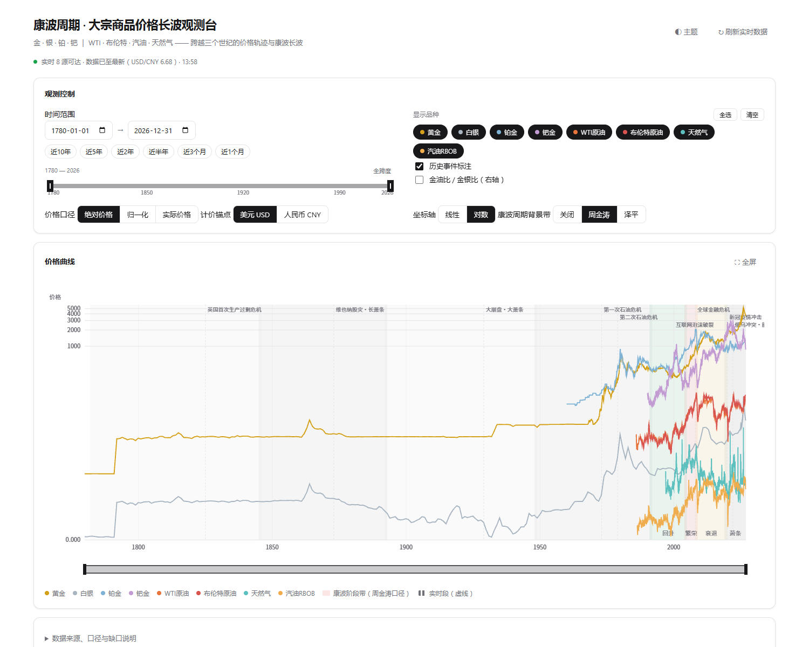

# 康波周期 · 大宗商品价格长波观测台

一个**可直接双击打开的单文件 HTML 工具**，把金 / 银 / 铂 / 钯 + WTI / 布伦特 / 汽油 / 天然气的价格曲线，按尽可能长的时间跨度画出来，叠加康波周期背景带，观察大宗商品价格与长波的对应关系。



## 打开方式

直接双击 `康波周期价格观测台.html`，无需安装、无需构建、无需联网（数据已内置）。推荐使用 Chrome / Edge。

## 数据覆盖

| 品种 | 起点 | 品种 | 起点 |
|---|---|---|---|
| 黄金 | 1258 年 | WTI 原油 | 1986 年 |
| 白银 | 1688 年 | 布伦特原油 | 1987 年 |
| 铂金 | 1960 年 | 天然气 | 1997 年 |
| 钯金 | 1990 年 | 汽油 RBOB | 1986 年 |

真正跨五轮康波的只有黄金和白银；能源品种仅覆盖第四波后半段至今。工具按各品种真实起点绘线，不外推补齐。

## 功能

- 8 个品种曲线叠加，可勾选、全选 / 清空
- 六档快捷区间（近 10 年 / 5 年 / 2 年 / 半年 / 3 个月 / 1 个月）+ 全跨度 + 双端时间滑块 + 拖拽平移 + 滚轮缩放
- 绝对价格 / 归一化 / 实际价格（CPI 平减）三种口径，线性 / 对数坐标
- 计价锚点切换（美元 / 人民币，按实时汇率折算）
- 周金涛 / 泽平两套康波四阶段背景带，可切换
- 历史事件标注，悬停显示时间段并高亮区间
- 鼠标十字准线 + 曲线交点同心圆强调
- 图表全屏，全屏下保留时间范围控制
- 金油比 / 金银比右轴
- 实时数据刷新（多个公开 API，失败静默降级到内置数据）

## 数据来源

MeasuringWorth、freegoldapi.com、thegoldrates.com、xaus.com、algospecial.com、World Bank Pink Sheet、GoldPrice.com、EIA（经 GitHub `datasets/oil-prices`）、FRED、api.gold-api.com、open.er-api.com。各段口径与拼接方式在页面底部"数据来源、口径与缺口说明"中如实标注。

## 目录结构

```
康波周期价格观测台.html   成品：单文件离线工具
template.html            页面模板
data/
  app.js                 应用逻辑（Canvas 绘图 + 交互 + 实时刷新）
  build_data.py          数据清洗脚本（原始 CSV/XLSX → commodities.json）
  build_html.py          构建脚本（模板 + 数据 + 逻辑 → 单文件 HTML）
  commodities.json       统一格式的数据
  verify.js              浏览器自动化验证脚本
  preview*.png           验证截图
```

## 重新构建

`build_data.py` 和 `verify.js` 内含本机绝对路径，在其他机器上使用时需先改成自己的路径：

```bash
python data/build_data.py     # 重建 commodities.json（需先下载原始数据到缓存目录）
python data/build_html.py     # 生成单文件 HTML
node data/verify.js           # Chrome 渲染验证（需 puppeteer-core）
```

## 实时数据源密钥

页面底部"实时数据源密钥配置"可填 Alpha Vantage 免费 key 以拉取能源实时数据；不填则使用内置数据。密钥只存在浏览器 localStorage，不写入项目文件。其余公开 API 无需配置。

## 免责声明

本工具基于公开数据分析，仅供参考，不构成投资建议。市场有风险，投资需谨慎。过往表现不预示未来收益。
